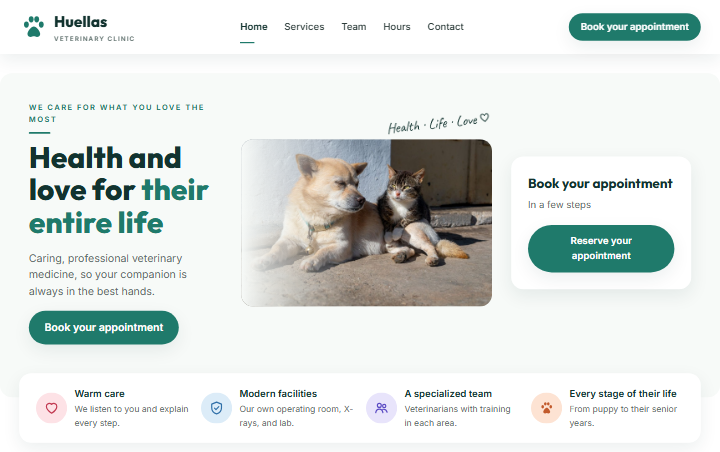

<p align="right">🌐 <b>English</b> · <a href="README.es.md">Español</a></p>

<p align="center">
  
</p>

<h1 align="center">&lt;CSS-HTML&gt;</h1>

<p align="center">
  <b>Learn to build web pages from scratch… by playing!</b><br>
  HTML, CSS and JavaScript in English and Spanish, step by step and with nothing to install.
</p>

<p align="center">
  
  
  
  
</p>

<p align="center">
  <a href="https://piradev-py.github.io/CSS-HTML/"></a>
</p>

<p align="center">
  
</p>

## 👋 What is this?

A course to learn how to make web pages **even if you've never programmed**.
It works like a video game: you move across a map of **4 worlds**, each lesson is short, you write your own
code and see the result instantly. **Tagui**, a tag with eyes, keeps you company with encouragement and tips.

🌐 **In two languages:** the whole course is in **English** and **Spanish** (lessons, challenges, glossary and the
final project). Switch languages whenever you like with the translate button at the top right; your progress stays the same.

## 🏥 The goal: your own complete website, from scratch

The whole course leads to a real project: **“Huellas”, a veterinary clinic's website**. It isn't a one-off
exercise: you build it yourself, world by world, with what you've just learned, like a real client job.

| World | What you add to Huellas |
|---|---|
| 🏗️ HTML | The whole page, well structured: header, services, team, opening hours, appointment form and footer. |
| 🎨 CSS | Its identity: colors, fonts, cards and buttons. |
| 🧩 HTML + CSS | The layout: it adapts to phones, with a folding menu and animations. |
| ⚡ JavaScript | Make it work: service filters, an appointment book that checks, saves and remembers, and reviews that arrive from a data file. |

When you finish, in **🏥 My clinic** you see your website full screen and **download it as a .zip** to open it on your
computer and show it to anyone you like. It's yours.

<p align="center">
  
</p>

## 🚀 Start now

### Option 1 · In the browser (the easiest)

👉 **[Open the course: piradev-py.github.io/CSS-HTML/](https://piradev-py.github.io/CSS-HTML/)** and press **🚀 Start**. That's it! 🎉

### Option 2 · On your computer, offline

1. At the top of this page, press the green **`<> Code`** button and then **Download ZIP**.
2. Unzip the folder you downloaded.
3. Open the folder and **double-click `index.html`**.

> 💡 Either way, you don't need to create an account or install any programs. Your progress is saved only in your
> browser (the website and the download keep separate progress).
> It's designed for a **computer or a tablet in landscape**.

## 🗺️ What you'll learn

| World | Lessons | When you finish it, you'll know how to… |
|---|:---:|---|
| 🏗️ **HTML** · *The bricks of every web page* | 14 | Write a complete page: headings, text, lists, links, images, tables and forms, well organized and accessible. |
| 🎨 **CSS** · *Give your pages color and style* | 15 | Change colors, fonts and sizes, understand why one style “wins” over another and place things with Flexbox and Grid. |
| 🧩 **HTML + CSS** · *Build real interfaces* | 11 | Make nice cards, menus and forms, pages that adapt to phones, and animations. |
| ⚡ **JavaScript** · *Bring your website to life* | 16 | Make your page react to clicks, check forms, save data and request information from a server. |

Each world ends with its **Web project**: the next step of Huellas.

<p align="center">
  
</p>

## 🎮 What a lesson looks like

The screen is split in three: **the lesson** on the left, **your code** in the middle and **the result** on the right.
Every lesson follows the same rhythm:

- 📖 **Explanation** with an example that really works.
- 🧠 **Exercise**: you write the code from scratch and press **Check**.
- 🎛️ **Controls** (in CSS): you move sliders and see how the code changes.
- ❓ **Quick question** to check you've understood it.
- 🏆 **Final challenge**: a list of goals that turn green as you type.

<p align="center">
  
</p>

<table>
  <tr>
    <td width="50%"></td>
    <td width="50%"></td>
  </tr>
  <tr>
    <td align="center"><b>Controls:</b> play with CSS without writing it</td>
    <td align="center"><b>Challenge:</b> each goal you meet turns green</td>
  </tr>
  <tr>
    <td width="50%"></td>
    <td width="50%"></td>
  </tr>
  <tr>
    <td align="center"><b>JavaScript:</b> interactive page and console</td>
    <td align="center"><b>Victory!</b> stars, XP and confetti</td>
  </tr>
</table>

> The screenshots show the course in Spanish; in English it looks the same, with English texts.

## ⭐ Stars, levels and badges

- ⭐⭐⭐ if you beat the challenge **without hints**, ⭐⭐ if you use hints and ⭐ if you look at the solution. You can repeat it to improve.
- You earn **XP** and level up: from 🐣 *Rookie* to 🚀 *Frontend Pro*.
- You unlock **badges** (finishing a world, collecting stars, practicing several days in a row…).
- A 🔥 **streak** counts the days in a row you practice.

## 🆘 If you get stuck

- 💡 Every exercise and challenge has **hints**, from small to big. After seeing them you can look at the solution.
- 🔍 The checker tells you **what's missing and where**: *“the `;` at the end of line 3 is missing”*, *“`<p>` isn't closed”*.
- 🐞 JavaScript errors are **explained for beginners**, with the line number.
- 🧪 **Test mode** lets you look at any lesson without it counting toward your progress.

## 🌙 Light and dark mode

Choose the theme with the 🌙 button at the top right.

<p align="center">
  
</p>

## ❓ Frequently asked questions

<details>
<summary><b>Do I need to know anything before I start?</b></summary>

Nothing. Just how to use a computer and a browser. Everything is explained from scratch: what a tag is, what a variable is…
</details>

<details>
<summary><b>Where is my progress saved? Can I lose it?</b></summary>

It's saved in your browser, on that computer. If you clear the browser's data or switch computers or
browsers, you'll start from zero. If you want to start over on purpose, use **Restart course** (at the bottom of the map).
</details>

<details>
<summary><b>Does it work offline?</b></summary>

Yes, if you use **option 2** (downloading it): the whole course works offline; with internet, only the fonts change.
</details>

<details>
<summary><b>Can I switch languages halfway through?</b></summary>

Yes. Press the translate button at the top right whenever you like: your stars, XP and badges stay the same.
</details>

<details>
<summary><b>Can I use it on my phone?</b></summary>

You can open it, but it's designed for a **computer or a tablet in landscape**: writing code on a phone is uncomfortable.
</details>

<details>
<summary><b>Can I leave a lesson halfway through?</b></summary>

Yes. Lessons are short and the code you write saves itself: when you come back, it's where you left it.
</details>

---

## 🛠️ For developers

<details>
<summary><b>How it's built</b></summary>

- **Plain HTML + CSS + JavaScript**, with no frameworks, no dependencies and no build step.
- Classic scripts (no modules or `fetch` of local files) so it works by double-clicking `index.html` (`file://`).
- Each exercise's result is rendered in an `<iframe srcdoc>` with a helper script that captures the console, translates
  errors, simulates `localStorage` and serves `fetch("datos/…")` offline.
- Progress, drafts and settings are saved in `localStorage`.
- Two languages: the interface texts go through `T("…")` (`js/textos.js`) and each lesson has its English copy in `lecciones-en/`.
</details>

<details>
<summary><b>Repository structure</b></summary>

| Folder / file | What it contains |
|---|---|
| `index.html` | Home: map of worlds and badges |
| `leccion.html?id=…` | A lesson's view (3 columns: lesson, code, result) |
| `mi-clinica.html` | The end of the course: the student's Huellas website and its .zip download |
| `css/` | Styles: theme, components, map and lesson |
| `js/curso.js` | **Course index**: worlds and lesson list (with each lesson's English title) |
| `js/textos.js` | The interface's English texts (`T("…")`) and the chosen language |
| `js/editor.js` | Live editor and result (console, errors, practice `localStorage`, simulated `fetch`, loop watchdog) |
| `js/ejercicios.js` | Exercise checker: compares with the solution (DOM, computed style, console, simulated actions) |
| `js/escritura.js` | Writing checker: closed tags, `{ }` and `;` in CSS and JS |
| `js/retos.js`, `js/pruebas.js` | Challenges and `PRUEBA` helpers (`:hover` states, widths, reload, typing…) |
| `js/` (rest) | Progress, map, controls, mascot, celebrations |
| `lecciones/` | Content: one `.js` file per lesson, in 4 folders (one per world), in Spanish |
| `lecciones-en/` | The same lessons in English, with the same file names; the English Huellas website is generated from the Spanish one by `herramientas/huellas-en.mjs` |
| `recursos/` | Lesson images, the Huellas website and the brand (Tagui's logo, icon) |
| `docs/PLAN_CURSO.md` | Full syllabus |
| `docs/FORMATO_LECCION.md` | Contract between the engine and the lessons: how a lesson is written |
| `docs/PROYECTO_FINAL.md` | The Huellas final project, task by task |
| `docs/PENDIENTES.md` | Living list of tasks and open decisions |
| `tests/` | Lesson checker and in-browser test scenarios |

The project docs (`docs/`) are in Spanish.
</details>

<details>
<summary><b>Adding or changing lessons</b></summary>

1. Read `docs/FORMATO_LECCION.md`: step types, how exercises are checked and how challenge checks are written.
2. Create the file in `lecciones/<world>/` and add it to `js/curso.js` with `listo: true`.
3. Open `tests/verificar-lecciones.html`: every lesson must show ✓ (the solution passes, the starting code doesn't, and everything is well written).
4. For the English version, copy it to `lecciones-en/` with the same name, add its `en: "…"` title in `js/curso.js` and
   run `node herramientas/lecciones-en.mjs <id>`, which compares it with the original.
5. Do the lesson as if you were a student.

In Claude Code, the `.claude/agents/profesor-frontend.md` agent writes lessons following that contract.
</details>

<details>
<summary><b>Automated browser tests</b></summary>

They need Node 22+ and Microsoft Edge. They drive a windowless Edge through DevTools (see `tests/navegador/LEEME.md`):

```bash
node tests/navegador/cdp.mjs esc-tests.mjs            # checks every lesson
IDIOMA=en node tests/navegador/cdp.mjs esc-tests.mjs  # the same, in English
node tests/navegador/cdp.mjs esc-motor.mjs            # CSS engine with state (hover, media queries…)
node tests/navegador/cdp.mjs esc-motor-js.mjs         # JavaScript World engine
MUNDO=4 node tests/navegador/cdp.mjs esc-mundo.mjs    # plays a whole world like a student
node tests/navegador/cdp.mjs esc-mi-clinica.mjs       # My clinic and its .zip download
node tests/navegador/cdp.mjs esc-capturas-readme.mjs  # retakes this README's screenshots
```
</details>
