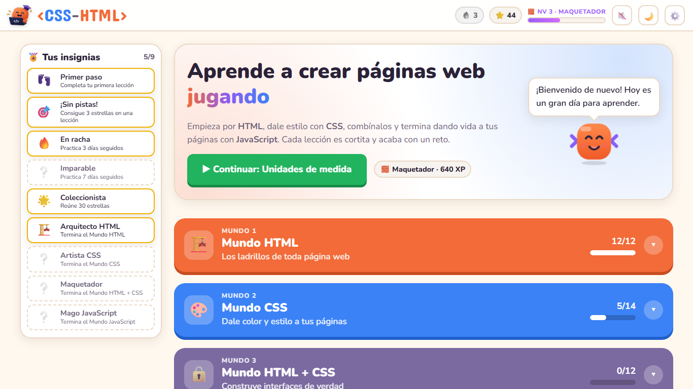
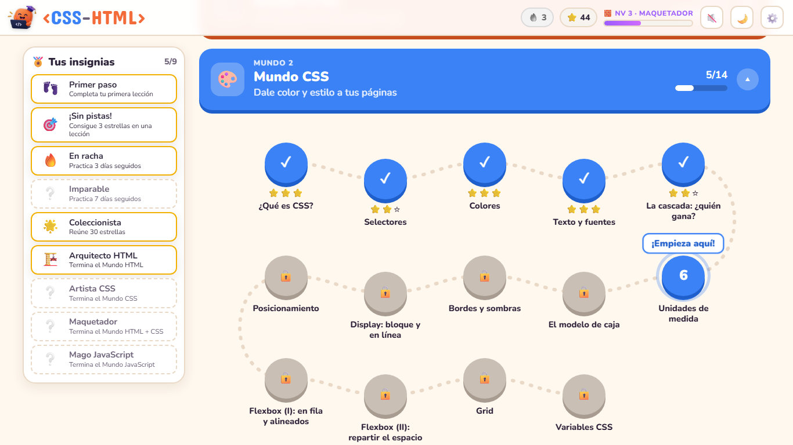
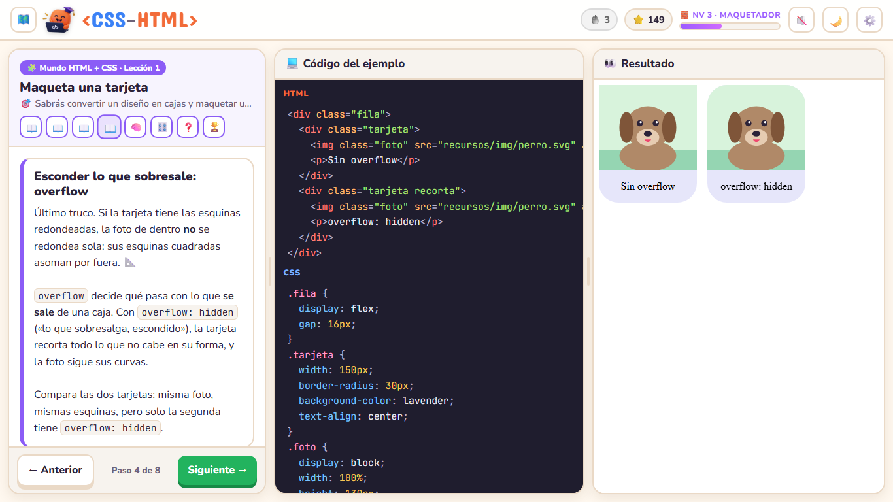
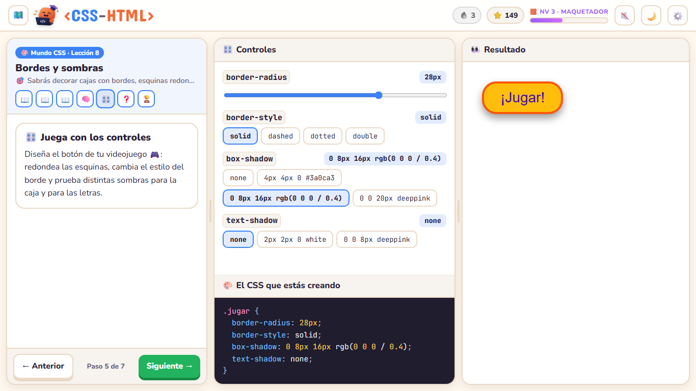
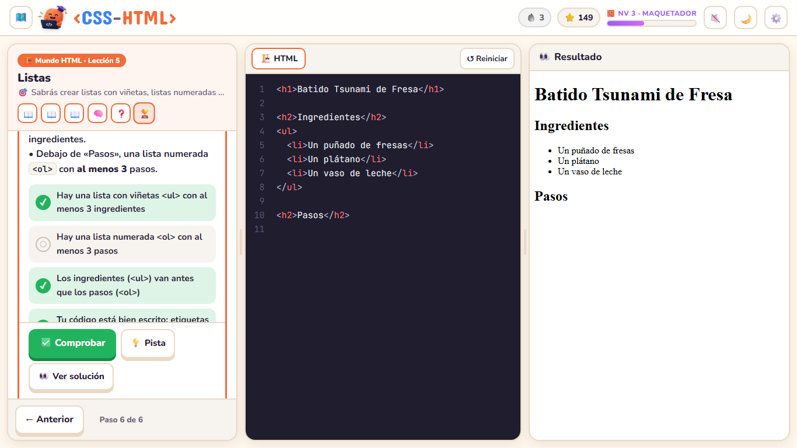
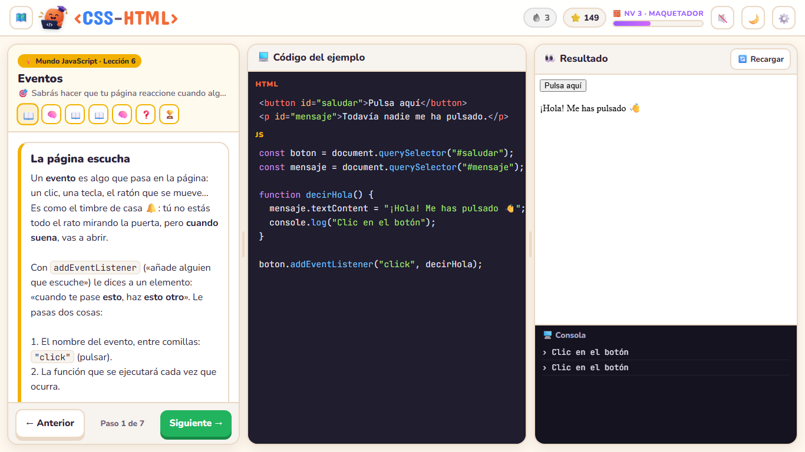
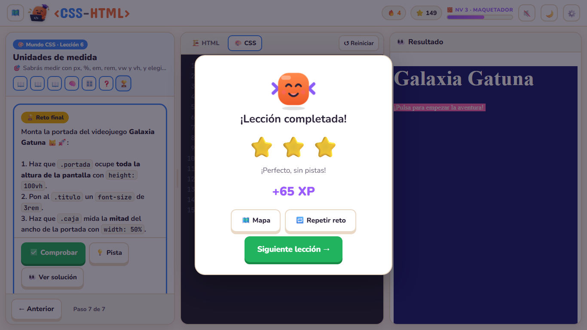
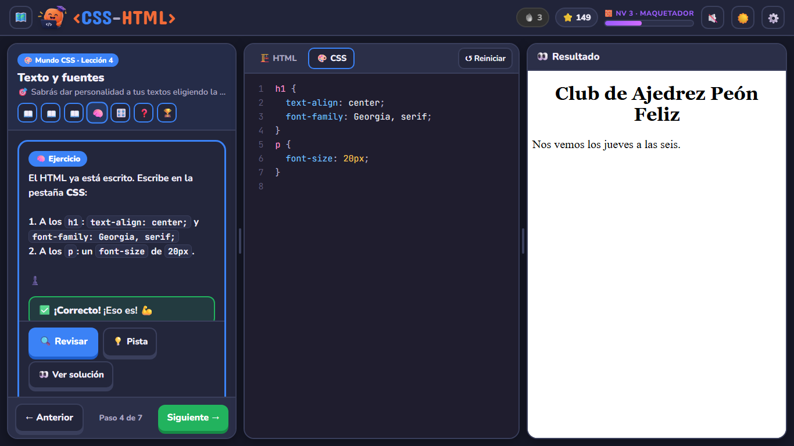

<p align="center">
  
</p>

<h1 align="center">&lt;CSS-HTML&gt;</h1>

<p align="center">
  <b>Aprende a crear páginas web desde cero… ¡jugando!</b><br>
  HTML, CSS y JavaScript en español, paso a paso y sin instalar nada.
</p>

<p align="center">
  
  
  
  
</p>

<p align="center">
  <a href="https://piradev-py.github.io/CSS-HTML/"></a>
</p>

<p align="center">
  
</p>

## 👋 ¿Qué es esto?

Un curso para aprender a hacer páginas web **aunque nunca hayas programado**.
Funciona como un videojuego: avanzas por un mapa de **4 mundos**, cada lección es cortita, escribes tu propio
código y ves el resultado al instante. Te acompaña **Tagui**, una etiqueta con ojos que te da ánimos y consejos.

## 🚀 Empieza ahora

### Opción 1 · En el navegador (lo más fácil)

👉 **[Abre el curso: piradev-py.github.io/CSS-HTML/](https://piradev-py.github.io/CSS-HTML/)** y pulsa **🚀 Empezar**. ¡Ya está! 🎉

### Opción 2 · En tu ordenador, sin internet

1. Arriba en esta página, pulsa el botón verde **`<> Code`** y después **Download ZIP**.
2. Descomprime la carpeta que se ha descargado.
3. Abre la carpeta y haz **doble clic en `index.html`**.

> 💡 En los dos casos no necesitas crear una cuenta ni instalar programas. Tu progreso se guarda solo en tu
> navegador (el de la web y el de la descarga van por separado).
> Está pensado para **ordenador o tablet en horizontal**.

## 🗺️ Qué vas a aprender

| Mundo | Lecciones | Al terminarlo sabrás… |
|---|:---:|---|
| 🏗️ **HTML** · *Los ladrillos de toda página web* | 12 | Escribir una página completa: títulos, textos, listas, enlaces, imágenes, tablas y formularios, bien ordenada y accesible. |
| 🎨 **CSS** · *Dale color y estilo a tus páginas* | 14 | Cambiar colores, letras y tamaños, entender por qué un estilo «gana» a otro y colocar cosas con Flexbox y Grid. |
| 🧩 **HTML + CSS** · *Construye interfaces de verdad* | 12 | Hacer tarjetas, menús y formularios bonitos, páginas que se adaptan al móvil, animaciones y una landing page completa. |
| ⚡ **JavaScript** · *Dale vida e interacción a tu web* | 14 | Que tu página reaccione a los clics, valide formularios, guarde datos y pida información a un servidor. Terminas creando tu propia **lista de tareas**. |

<p align="center">
  
</p>

## 🎮 Cómo es una lección

La pantalla se divide en tres: **la lección** a la izquierda, **tu código** en el centro y **el resultado** a la derecha.
Cada lección sigue el mismo ritmo:

- 📖 **Explicación** con un ejemplo que funciona de verdad.
- 🧠 **Ejercicio**: escribes tú el código desde cero y pulsas **Revisar**.
- 🎛️ **Controles** (en CSS): mueves deslizadores y ves cómo cambia el código.
- ❓ **Pregunta rápida** para comprobar que lo has entendido.
- 🏆 **Reto final**: una lista de objetivos que se van poniendo en verde mientras escribes.

<p align="center">
  
</p>

<table>
  <tr>
    <td width="50%"></td>
    <td width="50%"></td>
  </tr>
  <tr>
    <td align="center"><b>Controles:</b> juega con el CSS sin escribirlo</td>
    <td align="center"><b>Reto:</b> cada objetivo cumplido se pone en verde</td>
  </tr>
  <tr>
    <td width="50%"></td>
    <td width="50%"></td>
  </tr>
  <tr>
    <td align="center"><b>JavaScript:</b> página interactiva y consola</td>
    <td align="center"><b>¡Victoria!</b> estrellas, XP y confeti</td>
  </tr>
</table>

## ⭐ Estrellas, niveles e insignias

- ⭐⭐⭐ si superas el reto **sin pistas**, ⭐⭐ si usas pistas y ⭐ si miras la solución. Puedes repetirlo para mejorar.
- Ganas **XP** y subes de nivel: de 🐣 *Novato* a 🚀 *Frontend Pro*.
- Desbloqueas **insignias** (terminar un mundo, coleccionar estrellas, practicar varios días seguidos…).
- Una **racha** 🔥 cuenta los días seguidos que practicas.

## 🆘 Si te atascas

- 💡 Cada ejercicio y cada reto tienen **pistas**, de menos a más. Después de verlas puedes ver la solución.
- 🔍 El revisor te dice **qué falta y dónde**: *«falta el `;` al final de la línea 3»*, *«falta cerrar `<p>`»*.
- 🐞 Los errores de JavaScript salen **explicados para novatos**, con el número de línea.
- 🧪 El **modo prueba** te deja mirar cualquier lección sin que cuente para tu progreso.

## 🌙 Modo claro y oscuro

Elige el tema con el botón 🌙 de arriba a la derecha.

<p align="center">
  
</p>

## ❓ Preguntas frecuentes

<details>
<summary><b>¿Necesito saber algo antes de empezar?</b></summary>

Nada. Solo saber usar el ordenador y el navegador. Se explica todo desde cero: qué es una etiqueta, qué es una variable…
</details>

<details>
<summary><b>¿Dónde se guarda mi progreso? ¿Lo puedo perder?</b></summary>

Se guarda en tu navegador, en ese ordenador. Si borras los datos del navegador o cambias de ordenador o de
navegador, empezarás de cero. Si quieres empezar de nuevo a propósito, usa **Reiniciar curso** (al final del mapa).
</details>

<details>
<summary><b>¿Funciona sin internet?</b></summary>

Sí, si usas la **opción 2** (descargarlo): todo el curso funciona sin conexión; con internet solo cambian las fuentes de letra.
</details>

<details>
<summary><b>¿Puedo usarlo en el móvil?</b></summary>

Se puede abrir, pero está pensado para **ordenador o tablet en horizontal**: escribir código en un móvil es incómodo.
</details>

<details>
<summary><b>¿Puedo dejar una lección a medias?</b></summary>

Sí. Las lecciones son cortitas y el código que escribes se guarda solo: al volver, lo encuentras donde lo dejaste.
</details>

---

## 🛠️ Para programadores

<details>
<summary><b>Cómo está hecho</b></summary>

- **HTML + CSS + JavaScript puro**, sin frameworks, sin dependencias y sin paso de compilación.
- Scripts clásicos (sin módulos ni `fetch` de archivos locales) para que funcione abriendo `index.html` con doble clic (`file://`).
- El resultado de cada ejercicio se pinta en un `<iframe srcdoc>` con un script ayudante que captura la consola, traduce
  los errores, simula `localStorage` y sirve `fetch("datos/…")` sin internet.
- El progreso, los borradores y los ajustes se guardan en `localStorage`.
</details>

<details>
<summary><b>Estructura del repositorio</b></summary>

| Carpeta / archivo | Qué contiene |
|---|---|
| `index.html` | Inicio: mapa de mundos e insignias |
| `leccion.html?id=…` | Vista de una lección (3 columnas: lección, código, resultado) |
| `css/` | Estilos: tema, componentes, mapa y lección |
| `js/curso.js` | **Índice del curso**: mundos y lista de lecciones |
| `js/editor.js` | Editor en vivo y resultado (consola, errores, `localStorage` de práctica, `fetch` simulado, vigilante de bucles) |
| `js/ejercicios.js` | Revisor de ejercicios: compara con la solución (DOM, estilo calculado, consola, acciones simuladas) |
| `js/escritura.js` | Revisor de escritura: etiquetas cerradas, `{ }` y `;` en CSS y JS |
| `js/retos.js`, `js/pruebas.js` | Retos y ayudantes `PRUEBA` (estados `:hover`, anchos, recargar, escribir…) |
| `js/` (resto) | Progreso, mapa, controles, mascota, celebraciones |
| `lecciones/` | Contenido: un archivo `.js` por lección, en 4 carpetas (una por mundo) |
| `recursos/` | Imágenes de las lecciones y la marca (logo de Tagui, icono) |
| `docs/PLAN_CURSO.md` | Temario completo |
| `docs/FORMATO_LECCION.md` | Contrato entre el motor y las lecciones: cómo se escribe una lección |
| `docs/PENDIENTES.md` | Lista viva de tareas y decisiones abiertas |
| `tests/` | Verificador de lecciones y escenarios de prueba en el navegador |
</details>

<details>
<summary><b>Añadir o cambiar lecciones</b></summary>

1. Lee `docs/FORMATO_LECCION.md`: tipos de paso, cómo se revisan los ejercicios y cómo se escriben las comprobaciones de los retos.
2. Crea el archivo en `lecciones/<mundo>/` y ponlo en `js/curso.js` con `listo: true`.
3. Abre `tests/verificar-lecciones.html`: cada lección debe salir en ✓ (la solución aprueba, el código inicial no, y todo está bien escrito).
4. Haz la lección como si fueras un alumno.

En Claude Code, el agente `.claude/agents/profesor-frontend.md` redacta lecciones siguiendo ese contrato.
</details>

<details>
<summary><b>Pruebas automáticas en el navegador</b></summary>

Necesitan Node 22+ y Microsoft Edge. Controlan Edge sin ventana por DevTools (ver `tests/navegador/LEEME.md`):

```bash
node tests/navegador/cdp.mjs esc-tests.mjs          # verifica todas las lecciones
node tests/navegador/cdp.mjs esc-motor.mjs          # motor de CSS con estado (hover, media queries…)
node tests/navegador/cdp.mjs esc-motor-js.mjs       # motor del Mundo JavaScript
MUNDO=4 node tests/navegador/cdp.mjs esc-mundo.mjs  # recorre un mundo entero como un alumno
node tests/navegador/cdp.mjs esc-capturas-readme.mjs  # rehace las capturas de este README
```
</details>
